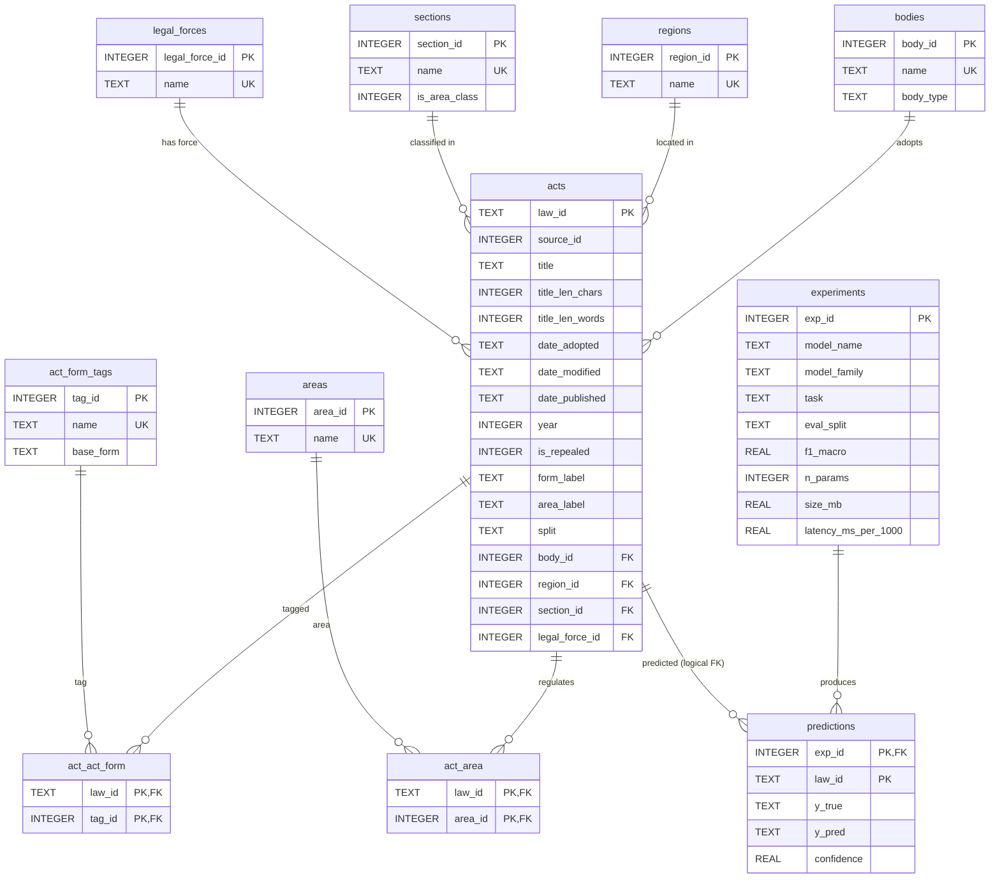

# ER diagram (Mermaid)

Rendered version: `reports/figures/er_diagram.png` (generated by `python -m src.database`).
Schema source: `sql/schema.sql`; experiment tables: `src/experiments_db.py`.

Normalisation notes:
* `act_form` and `legal_relation_area` are multi-valued -> many-to-many link tables
  (`act_act_form`, `act_area`), so the 863 raw `act_form` strings collapse to a small tag dictionary
  and the ~25k area combinations collapse to a few hundred area names.
* Repeated text attributes (body, region, section, legal force) are lookup tables referenced by integer FKs (3NF).
* `form_label`, `area_label`, `split` are derived ML labels kept on `acts` for analysis convenience.
