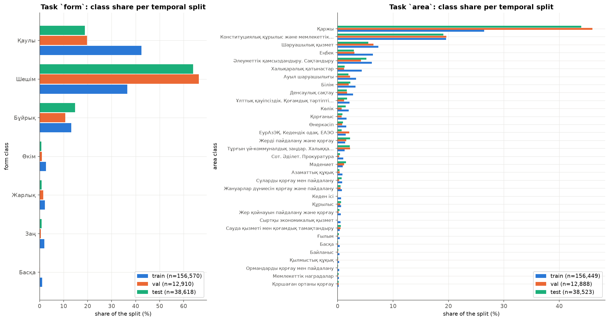
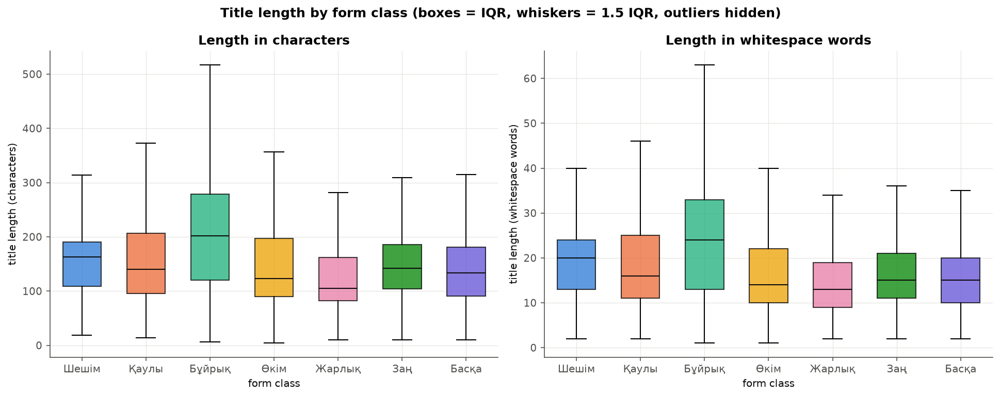
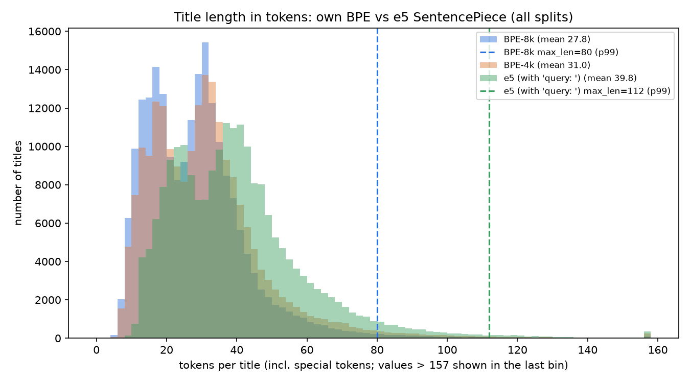

# Tiny Transformer for Legal Act Classification

**Course:** Programming for AI, Astana IT University, MSc Applied Artificial Intelligence
**Topic #24, Cluster 5:** Lightweight Transformer Models for Kazakh Text
**Team (AAI-2603M):** Ilyas Nagiyev, Beksultan Aliyev, Yernur Baimukhambetov
**Dataset:** KazakhLawCorpus-clean (215,889 Kazakh legal acts, CC BY 4.0)

<!-- ABSTRACT -->

## 1. Task and research questions

The project classifies Kazakh normative legal acts **from their titles only** into two label sets:

- **Task `form`, the act form (7 classes):** Заң (law), Жарлық (decree), Қаулы (resolution), Шешім (decision), Бұйрық (order), Өкім (directive) and Басқа (other).
- **Task `area`, the regulation area (33 classes):** the curated `database_section` field, for example Қаржы (finance), Білім (education) or Денсаулық сақтау (health). Rare areas are merged into Басқа.

The research questions follow the topic definition:

1. How close can a **tiny transformer trained from scratch** (own BPE tokenizer, at most 10M parameters) get to a **TF-IDF + logistic regression** baseline and to a **fine-tuned compact pretrained model** (at most 120M parameters)?
2. What do we pay for quality in parameters, model size (MB) and inference latency per 1000 titles?
3. How much do the scores depend on the evaluation protocol? We compare a temporal split with a near-duplicate-free test subset.

Model choices were made on the validation year only. Test scores are reported once, for every model, from the same SQLite experiment table.

## 2. Data

### 2.1 Source and size

The corpus is distributed as a single 337 MB CSV file: 215,889 rows, 25 columns, with acts adopted from 1947-10-30 to 2026-07-20. Each row is one legal act with its Kazakh title, a short description and metadata: dates, issuing body, region, legal force, act form and regulation area.

### 2.2 Memory-aware loading (requirement 11)

The CSV is never loaded in one piece as object dtype. `src/data_io.py` streams it in chunks of 20,000 rows. In each chunk it turns source placeholders into missing values, converts low-cardinality columns to `category`, the `is_*` flags to `bool`, the dates to `datetime64` and the registry numbers to `Int32`. The chunks are written incrementally with a `pyarrow` `ParquetWriter`.

| Representation | Memory (MB) |
|---|---|
| object dtype (sum over chunks, `memory_usage(deep=True)`) | 636.9 |
| pandas 3 default dtypes | 353.5 |
| optimized dtypes | **201.3** (−68.4 % vs object, −43 % vs default) |

| Format | File size | Full read | 5-column read | Peak RSS growth (full) |
|---|---|---|---|---|
| CSV | 321.2 MB | 0.44 s | 0.18 s | 720 MB |
| CSV, chunked | — | 0.38 s | — | **150 MB** |
| Parquet (zstd) | **25.8 MB** | **0.23 s** | **0.025 s** | 1,103 MB |

Parquet is 12.5× smaller and 7× faster for column subsets. Every model reads only the 5 columns it needs. A full Parquet read briefly allocates more memory than the CSV read because of Arrow buffers and the category conversion. We report this as measured: for a memory-bounded full scan, chunked CSV streaming is the cheapest option.

### 2.3 Data-quality audit

`src/audit.py` writes `results/audit_report.md`. Its main findings:

- **Placeholders hide missing values.** `regulatory_body` looks 99.99 % complete if only empty strings are counted, but 93,272 rows (43.2 %) hold the placeholder "ЖОҚ". `gov_registration_number` uses both "НЕТ" and "undefined". We count placeholders separately from true NaN and map them to missing.
- **The model inputs are almost complete.** `title` and `date_adopted` have 0 % missing, `act_form` 0.03 % (63 rows) and `database_section` 0.11 % (240 rows, including the numeric junk codes "3700" and "3800").
- **Dates are valid.** There are no unparseable or future adoption dates. 62 acts predate independence (1991), and a handful have `date_modified < date_adopted`; these are kept and documented.
- **Two fields hold several values each.** `act_form` is an unordered tag list ("Шешім, Өзгерту" means the same as "Өзгерту, Шешім"): 863 raw combinations of 76 tags. `legal_relation_area` is a list of areas whose names can themselves contain commas, so a naive split on ", " gives 450 fragments. Our vocabulary-aware splitter recovers the 336 real areas.
- **One column is constant.** `is_archive` has a single value, so it is not used.
- **Duplicates.** `law_id` is unique, but 76,460 rows share their exact title with another act (22,544 distinct titles). Kazakh legal titles are highly templated, for example annual budget decisions of each maslikhat.

### 2.4 Label construction (`src/labels.py`)

- **Form.** The act form is the highest-ranked *legal instrument* tag among the act's tags, using the hierarchy Заң > Жарлық > Қаулы > Шешім > Бұйрық > Өкім. The aliases "Конституциялық Заң", "Заң күші бар Жарлық" and "Нормативтік қаулы" map to their base forms. Modifier tags such as Өзгерту (amendment), Толықтыру (addition) or Жоба (draft) are not forms. They are kept in the many-to-many table `act_act_form` in SQLite. Acts with no recognised instrument become Басқа. The 60 acts with an empty `act_form` are *unlabelled* and are excluded from this task.
- **Area.** The area label is `database_section` (37 real sections). Sections with fewer than 300 **training** rows are merged into Басқа, which gives 33 classes. The rare-class decision uses training counts only.

## 3. Relational database and SQL (requirement 10)

`src/database.py` normalizes the corpus into a SQLite database (`data/kazlaw.db`, schema in `sql/schema.sql`) and loads it in chunks with `executemany`. Indexes are created after loading (`sql/indexes.sql`).

- **Fact table:** `acts`, with one row per act (law_id, title, dates, year, is_repealed, form_label, split), linked by foreign keys to the dimension tables.
- **Dimension tables:** `bodies` (adopting body, with a derived body type: Мәслихат, Әкімдік, Министрлік, Үкімет…), `regions`, `sections` and `legal_forces`.
- **Many-to-many links:** `act_form_tags` + `act_act_form` (all act-form tags, including the modifiers) and `areas` + `act_area` (the 336 legal-relation areas).
- **Experiment tables:** `experiments` (one row per model × task × evaluation split, with every metric) and `predictions` (one row per model × test act). Every model in the project logs into these through `src/experiments_db.py`, so the final model comparison is itself an SQL query.

`sql/queries.sql` contains 17 named queries. `database.run_queries()` runs each one into a pandas DataFrame and saves it to `results/sql/<name>.csv`.

| Query | SQL features | Question answered |
|---|---|---|
| acts_per_year_by_form | GROUP BY | acts per year and form (EDA figure) |
| top_adopting_bodies | JOIN, GROUP BY | top 15 issuers, their activity period and repeal share (EDA figure) |
| body_type_form_having | JOIN, GROUP BY, HAVING | frequent (body type, form) pairs: the form largely follows from the issuer |
| yoy_change_by_form | CTE, window (LAG), subquery | year-over-year change per form |
| running_total_by_year | CTE, window (running SUM), subquery | cumulative corpus growth and repeal rate |
| form_share_within_split | window (share within partition) | label shift created by the temporal split |
| top_areas_per_form | JOIN, CTE, window (RANK), subquery | 3 most frequent regulation areas per form |
| repeal_rate_by_section | JOIN, GROUP BY, HAVING | sections with the highest repeal share |
| multi_area_acts_by_form | JOIN, CTE, subquery | acts tagged with more areas than average |
| form_tag_cooccurrence | JOIN (self-join), GROUP BY | which act-form tags co-occur |
| title_length_by_form | CTE | title length per form (max sequence length) |
| area_form_matrix | CTE | joint distribution of the two targets (EDA heatmap) |
| acts_by_body_type | JOIN, window | share of acts by body type (local bodies: 59.7 %) |
| top_regions_recent_rank | JOIN, CTE, window (DENSE_RANK), subquery | most active regions in 2019–2026 |
| model_ranking_per_task | CTE, window (RANK) | model leaderboard per task and split, with the gap to the best |
| per_class_error_rate | JOIN predictions ⋈ acts | per-model, per-class test error rate and confidence |
| error_rate_by_year | JOIN, CTE, window, subquery | does the error rate grow with adoption year (temporal drift)? |

The query results feed the analysis directly. Four EDA figures are drawn from SQL output, and the model leaderboard and part of the error analysis come from SQL over the `experiments` and `predictions` tables.

## 4. Exploratory data analysis

`src/eda.py` produces the figures below. Every claim in `results/eda_summary.json` is computed from the data, not written by hand.

- **Label shift.** In the form task, Шешім (decision) grows from 36.5 % of train to 64.1 % of test, while Қаулы (resolution) falls from 42.4 % to 18.8 %. In the area task, Қаржы (finance) grows from 26.4 % to 44.1 %. This shift is the main difficulty of the temporal protocol and the reason macro-F1 is the headline metric.

- **Volume over time.** Volume peaks in 2023 with 15,092 acts. The share of Шешім rises from 36 % in 2011 to 62 % in 2023: more and more acts are local maslikhat decisions.

- **Title length.** The median title has 158 characters and 19 words (p95 336, max 4,071). Жарлық titles are the shortest (median 105 characters) and Бұйрық titles the longest (202). With our 8k BPE tokenizer the median title has 25 tokens and p99 is 78, so the tiny transformer uses a maximum sequence length of 80 tokens.
- **Issuers.** Local bodies (maslikhats, akimats and akims; 3,147 distinct bodies) adopt 59.7 % of all acts. The Government (Үкімет) is the largest single issuer with 37,807 acts.
- **Correlation of the two targets.** The two targets are correlated but not redundant. In 7 of the 33 areas a single form covers at least 70 % of the acts (Қаржы: 79.6 % Шешім), while in the most mixed area no form exceeds 36 %.

## 5. Evaluation protocol and leakage control

### 5.1 Temporal split

We split by adoption date, so every model is trained on the past and evaluated on the future:

| Split | Years | Rows |
|---|---|---|
| train | 1947–2021 | 156,570 |
| val | 2022 | 12,863 |
| test | 2023–2026 | 38,471 |

### 5.2 Duplicate and near-duplicate control

1. **Exact duplicates.** A val or test title whose normalized form (NFC, lower-case, punctuation removed, Latin look-alike letters folded to Cyrillic) occurs in train is removed (7,030 rows), and likewise test titles seen in val (955 rows). Afterwards the exact overlap between splits is 0.
2. **Templated near-duplicates.** Kazakh legal titles are produced from templates; often only the year or a number changes. `src/leakage.py` fits a character 3–5-gram TF-IDF model on **digit-masked** train titles and computes, for each test title, its maximum cosine similarity to any train title. The sparse products are batched and never densified.
   - 54.2 % of test titles have a train neighbour with cosine ≥ 0.9.
   - 20.6 % are identical to a train title up to the digits.
3. **`test_strict`** is the 17,629 test titles (45.8 %) with no digit-masked exact match and no neighbour at cosine ≥ 0.9. Every model is scored on both `test` and `test_strict`. The near-duplicate structure shows up directly: a 1-nearest-neighbour classifier on these char n-grams (`char_1nn`) reaches 0.94 accuracy on the form task's validation year. Its macro-F1 is only 0.67, because copying the label of the nearest old title works for the large template classes but fails for the rare ones.

### 5.3 Metrics

The primary metric is **macro-F1**. The test set is dominated by one class (Шешім is 64 % of test), so accuracy mostly measures that class. Macro-F1 is averaged over the classes present in the evaluated split (`src/metrics.py`), which keeps the label set identical for every model. We also report accuracy, weighted F1, parameter count, size on disk, CPU latency per 1000 titles (batch 64, 8 threads, median of 3 runs), peak memory and training time.

## 6. Text preprocessing and tokenization

**Kazakh normalization (`src/text_prep.py`).** Normalization steps:

- NFC and lower-casing.
- Folding Latin look-alike letters to Cyrillic inside Cyrillic words. 10.9 % of titles contain, for example, a Latin "i" in place of the Kazakh "і".
- A regex tokenizer that keeps the Kazakh-specific letters (ә ғ қ ң ө ұ ү һ і).
- A stop-word list of 53 words: 43 function words plus 10 pieces of legal boilerplate such as "қазақстан", "республикасының" and "жылғы". A word goes on the list when its class distribution is close to the class prior (KL ≈ 0), which means it carries no class information.

**Agglutinative morphology.** Kazakh builds word forms by stacking suffixes. We compare three ways of handling this:

| Representation | Vocabulary (train) | Test OOV | Form test F1 (TF-IDF + LR) |
|---|---|---|---|
| word forms (1–2-grams) | 31,240 | 0.38 % | 0.803 |
| suffix-stripped stems (rule-based) | 18,652 (−40 %) | 0.33 % | 0.783 |
| character 2–5-grams | 174,054 | 0.60 % | 0.778 |
| word + character n-grams | — | — | **0.820** |

The stemmer iteratively strips plural, possessive and case suffixes, with a minimum stem length and a lexicon learned on train. Stemming shrinks the vocabulary by 40 %, but it does not improve classification. Legal titles are formulaic, so the suffixes themselves carry signal: the case of the issuer's name, for instance. The best baseline combines word and character n-grams.

**Preprocessing ablation (`src/prep_ablation.py`, TF-IDF + LR, val-selected).** We tested four variants on the form task (test macro-F1):

| Variant | Form test F1 |
|---|---|
| raw text | 0.798 |
| digits replaced by a single token | 0.808 |
| homoglyph folding + digit token | 0.803 |
| homoglyph folding + all digits masked | 0.793 |

The differences are within about 1.5 points, so normalization is not the bottleneck.

**Subword tokenizers.** We trained our own byte-level BPE tokenizer (`src/bpe_tokenizer.py`) with HF `tokenizers` on **train titles only** (8k vocabulary; a 4k vocabulary was the ablation). It has 0 unknown tokens and 0 round-trip errors on held-out titles. Its fertility is 1.31 tokens per word, compared with 1.73 for the 250k multilingual SentencePiece vocabulary of e5-small and 1.26 for the monolingual Kazakh RoBERTa vocabulary. A Kazakh-specific vocabulary therefore gives shorter sequences.

## 7. Models

<!-- MODELS -->

## 8. Results

<!-- RESULTS -->

## 9. Error analysis

<!-- ERRORS -->

## 10. Software implementation

<!-- SOFTWARE -->

## 11. Limitations

<!-- LIMITS -->

## 12. Conclusions

<!-- CONCLUSIONS -->

## 13. Team contributions

<!-- TEAM -->

## References

1. Tleubayeva, A. (Hugging Face user Arailym-tleubayeva). *KazakhLawCorpus-clean* [dataset]. Hugging Face. https://huggingface.co/datasets/Arailym-tleubayeva/KazakhLawCorpus-clean
2. Vaswani, A. et al. Attention Is All You Need. NeurIPS, 2017.
3. Wang, L. et al. Multilingual E5 Text Embeddings: A Technical Report. arXiv:2402.05672, 2024.
4. Hinton, G., Vinyals, O., Dean, J. Distilling the Knowledge in a Neural Network. arXiv:1503.02531, 2015.
5. Xue, L. et al. mT5: A Massively Multilingual Pre-trained Text-to-Text Transformer. NAACL, 2021.
6. Sennrich, R., Haddow, B., Birch, A. Neural Machine Translation of Rare Words with Subword Units (BPE). ACL, 2016.
7. Pedregosa, F. et al. Scikit-learn: Machine Learning in Python. JMLR 12, 2011.
8. Paszke, A. et al. PyTorch: An Imperative Style, High-Performance Deep Learning Library. NeurIPS, 2019.
9. Wolf, T. et al. Transformers: State-of-the-Art Natural Language Processing. EMNLP (Demos), 2020.
10. kz-transformers. *kaz-roberta-conversational* [model card]. Hugging Face. https://huggingface.co/kz-transformers/kaz-roberta-conversational
