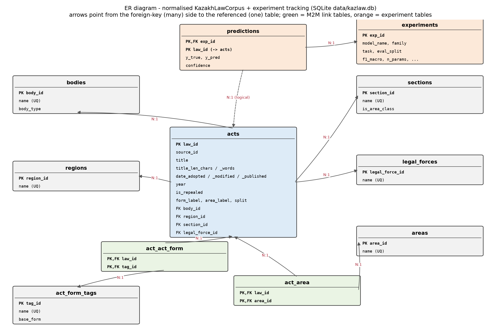
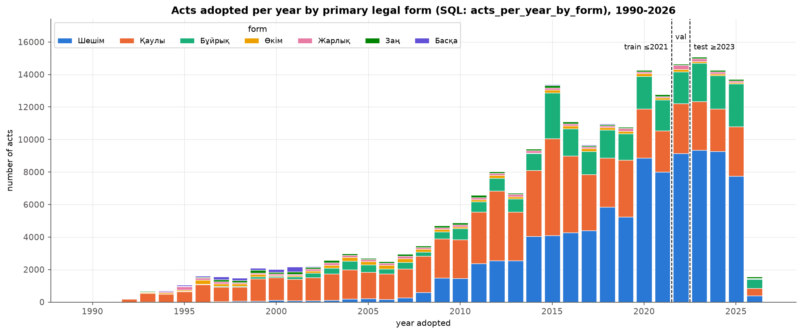
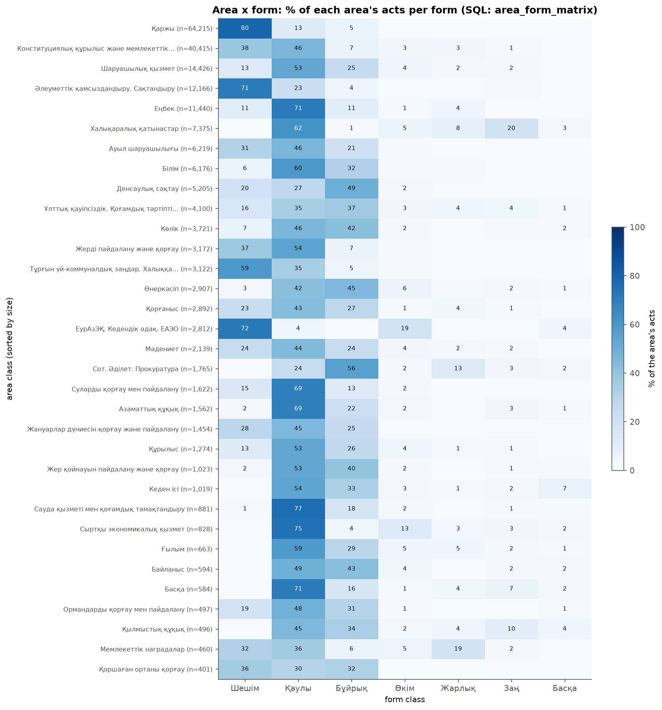
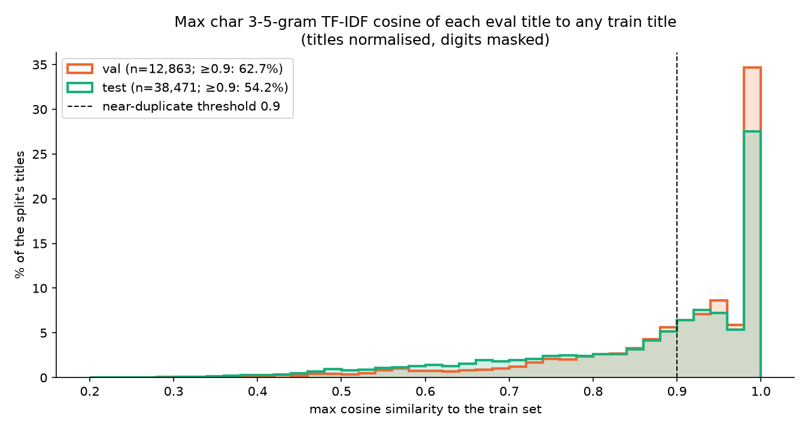
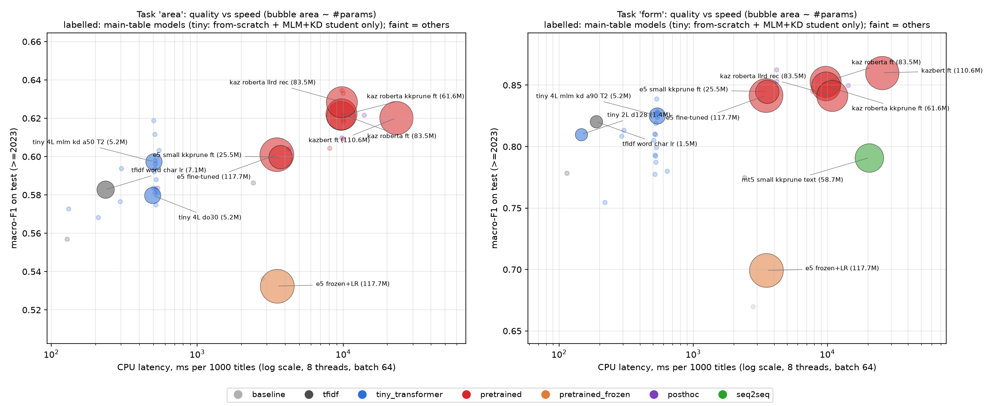
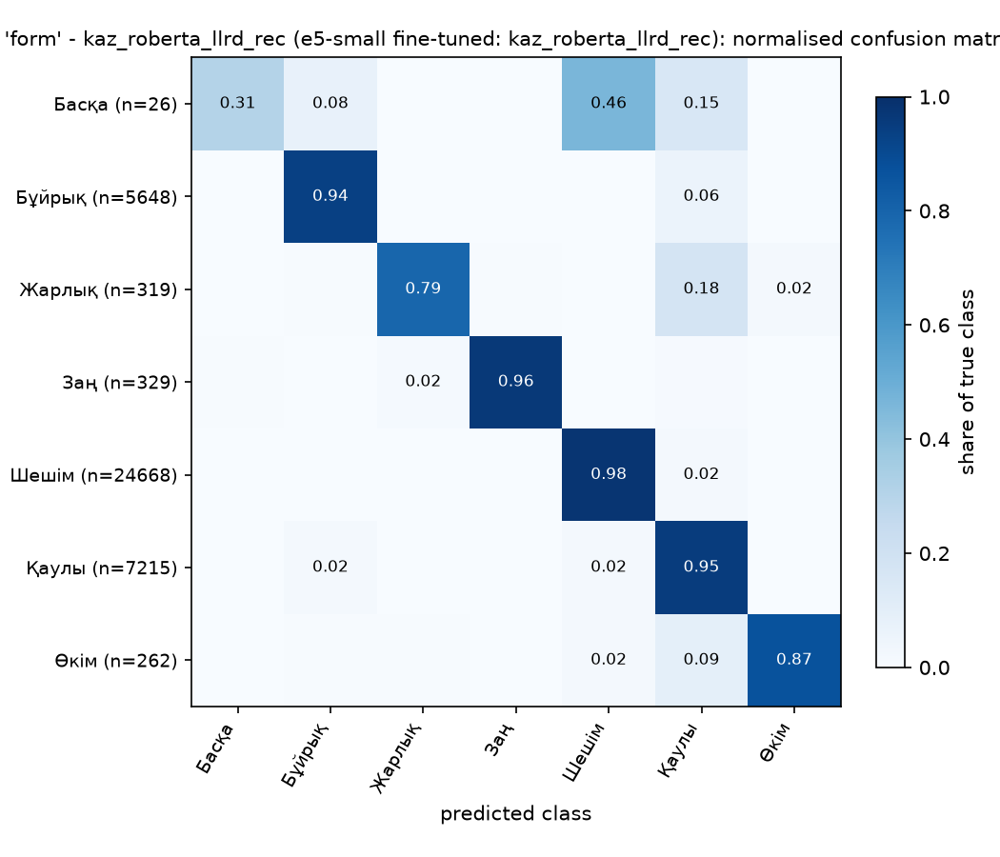
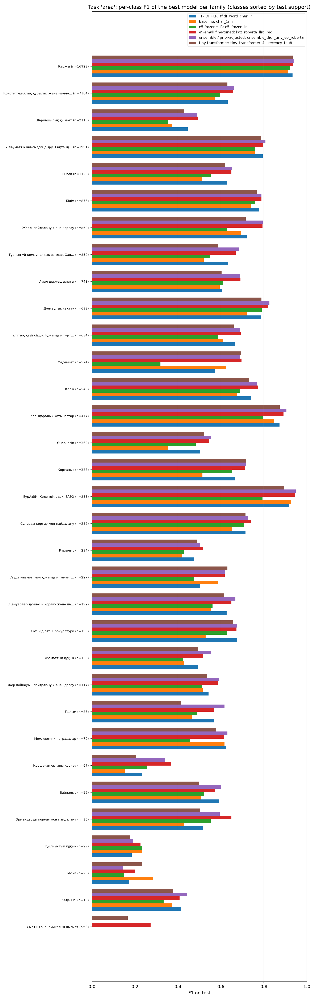

# Tiny Transformer for Legal Act Classification

**Course:** Programming for AI, Astana IT University, MSc Applied Artificial Intelligence
**Topic #24, Cluster 5:** Lightweight Transformer Models for Kazakh Text
**Team (AAI-2603M):** Ilyas Nagiyev, Beksultan Aliyev, Yernur Baimukhambetov
**Dataset:** KazakhLawCorpus-clean (215,889 Kazakh legal acts, CC BY 4.0)

**Abstract.** We classify 215,889 Kazakh legal acts by **act form** (7 classes) and **regulation area** (33 classes) from their titles alone, under a temporal split (train ≤ 2021, validation 2022, test ≥ 2023). We also use a near-duplicate-free test subset, because 54 % of test titles are templated copies of earlier acts. We compare:

- TF-IDF + logistic regression;
- a transformer written and trained from scratch with our own BPE tokenizer (1.4–5.2M parameters);
- compact pretrained encoders (multilingual-e5-small, kaz-roberta, KazBERT);
- vocabulary pruning, seq2seq generation (mT5), knowledge distillation (including an LLM teacher), prior-shift correction and ensembles.

The best models within the 120M budget are the Kazakh encoders kaz-roberta and KazBERT. On test they reach 0.841–0.860 macro-F1 on form and 0.620–0.629 on area, 0.02–0.05 above TF-IDF. Their confidence intervals overlap, so we treat them as tied. We pretrain the 5.2M-parameter tiny transformer with MLM and distill it from the averaged predictions of the two Kazakh encoders. It then ties TF-IDF on form (0.839) and beats it significantly on area (0.619), coming within 0.01–0.02 of the best encoders at 1/7 of e5-small's CPU latency and 1/18 of kaz-roberta's. The data pipeline streams the 337 MB CSV into Parquet (−68 % memory). A normalized SQLite database with 17 analytic queries stores both the corpus and every experiment.

## 1. Task and research questions

The project classifies Kazakh normative legal acts **from their titles only** into two label sets:

- **Task `form`, the act form (7 classes):** Заң (law), Жарлық (decree), Қаулы (resolution), Шешім (decision), Бұйрық (order), Өкім (directive) and Басқа (other).
- **Task `area`, the regulation area (33 classes):** the curated `database_section` field, for example Қаржы (finance), Білім (education) or Денсаулық сақтау (health). Rare areas are merged into Басқа.

The research questions follow the topic definition:

1. How close can a **tiny transformer trained from scratch** (own BPE tokenizer, at most 10M parameters) get to a **TF-IDF + logistic regression** baseline and to a **fine-tuned compact pretrained model** (at most 120M parameters)?
2. What do we pay for quality in parameters, model size (MB) and inference latency per 1000 titles?
3. How much do the scores depend on the evaluation protocol? We compare a temporal split with a near-duplicate-free test subset.

Model choices were made on the validation year only. Test scores are reported once, for every model, from the same SQLite experiment table.

## 2. Data

### 2.1 Source and size

The corpus is distributed as a single 337 MB CSV file: 215,889 rows, 25 columns, with acts adopted from 1947-10-30 to 2026-07-20. Each row is one legal act with its Kazakh title, a short description and metadata: dates, issuing body, region, legal force, act form and regulation area.

### 2.2 Memory-aware loading (requirement 11)

The CSV is never loaded in one piece as object dtype. `src/data_io.py` streams it in chunks of 20,000 rows. In each chunk it turns source placeholders into missing values, converts low-cardinality columns to `category`, the `is_*` flags to `bool`, the dates to `datetime64` and the registry numbers to `Int32`. The chunks are written incrementally with a `pyarrow` `ParquetWriter`.

| Representation | Memory (MB) |
|---|---|
| object dtype (sum over chunks, `memory_usage(deep=True)`) | 636.9 |
| pandas 3 default dtypes | 353.5 |
| optimized dtypes | **201.3** (−68.4 % vs object, −43 % vs default) |

| Format | File size | Full read | 5-column read | Peak RSS growth (full) |
|---|---|---|---|---|
| CSV | 321.2 MB | 0.44 s | 0.18 s | 720 MB |
| CSV, chunked | — | 0.38 s | — | **150 MB** |
| Parquet (zstd) | **25.8 MB** | **0.23 s** | **0.025 s** | 1,103 MB |

Parquet is 12.5× smaller and 7× faster for column subsets. Every model reads only the 5 columns it needs. A full Parquet read briefly allocates more memory than the CSV read because of Arrow buffers and the category conversion. We report this as measured: for a memory-bounded full scan, chunked CSV streaming is the cheapest option.

### 2.3 Data-quality audit

`src/audit.py` writes `results/audit_report.md`. Its main findings:

- **Placeholders hide missing values.** `regulatory_body` looks 99.99 % complete if only empty strings are counted, but 93,272 rows (43.2 %) hold the placeholder "ЖОҚ". `gov_registration_number` uses both "НЕТ" and "undefined". We count placeholders separately from true NaN and map them to missing.
- **The model inputs are almost complete.** `title` and `date_adopted` have 0 % missing, `act_form` 0.03 % (63 rows) and `database_section` 0.11 % (240 rows, including the numeric junk codes "3700" and "3800").
- **Dates are valid.** There are no unparseable or future adoption dates. 62 acts predate independence (1991), and a handful have `date_modified < date_adopted`; these are kept and documented.
- **Two fields hold several values each.** `act_form` is an unordered tag list ("Шешім, Өзгерту" means the same as "Өзгерту, Шешім"): 863 raw combinations of 76 tags. `legal_relation_area` is a list of areas whose names can themselves contain commas, so a naive split on ", " gives 450 fragments. Our vocabulary-aware splitter recovers the 336 real areas.
- **One column is constant.** `is_archive` has a single value, so it is not used.
- **Duplicates.** `law_id` is unique, but 76,460 rows share their exact title with another act (22,544 distinct titles). Kazakh legal titles are highly templated, for example annual budget decisions of each maslikhat.

### 2.4 Label construction (`src/labels.py`)

- **Form.** The act form is the highest-ranked *legal instrument* tag among the act's tags, using the hierarchy Заң > Жарлық > Қаулы > Шешім > Бұйрық > Өкім. The aliases "Конституциялық Заң", "Заң күші бар Жарлық" and "Нормативтік қаулы" map to their base forms. Modifier tags such as Өзгерту (amendment), Толықтыру (addition) or Жоба (draft) are not forms. They are kept in the many-to-many table `act_act_form` in SQLite. Acts with no recognised instrument become Басқа. The 60 acts with an empty `act_form` are *unlabelled* and are excluded from this task.
- **Area.** The area label is `database_section` (37 real sections). Sections with fewer than 300 **training** rows are merged into Басқа, which gives 33 classes. The rare-class decision uses training counts only.

## 3. Relational database and SQL (requirement 10)

`src/database.py` normalizes the corpus into a SQLite database (`data/kazlaw.db`, schema in `sql/schema.sql`) and loads it in chunks with `executemany`. Indexes are created after loading (`sql/indexes.sql`).

- **Fact table:** `acts`, with one row per act (law_id, title, dates, year, is_repealed, form_label, split), linked by foreign keys to the dimension tables.
- **Dimension tables:** `bodies` (adopting body, with a derived body type: Мәслихат, Әкімдік, Министрлік, Үкімет…), `regions`, `sections` and `legal_forces`.
- **Many-to-many links:** `act_form_tags` + `act_act_form` (all act-form tags, including the modifiers) and `areas` + `act_area` (the 336 legal-relation areas).
- **Experiment tables:** `experiments` (one row per model × task × evaluation split, with every metric) and `predictions` (one row per model × test act). Every model in the project logs into these through `src/experiments_db.py`, so the final model comparison is itself an SQL query.

`sql/queries.sql` contains 17 named queries. `database.run_queries()` runs each one into a pandas DataFrame and saves it to `results/sql/<name>.csv`.

| Query | SQL features | Question answered |
|---|---|---|
| acts_per_year_by_form | GROUP BY | acts per year and form (EDA figure) |
| top_adopting_bodies | JOIN, GROUP BY | top 15 issuers, their activity period and repeal share (EDA figure) |
| body_type_form_having | JOIN, GROUP BY, HAVING | frequent (body type, form) pairs: the form largely follows from the issuer |
| yoy_change_by_form | CTE, window (LAG), subquery | year-over-year change per form |
| running_total_by_year | CTE, window (running SUM), subquery | cumulative corpus growth and repeal rate |
| form_share_within_split | window (share within partition) | label shift created by the temporal split |
| top_areas_per_form | JOIN, CTE, window (RANK), subquery | 3 most frequent regulation areas per form |
| repeal_rate_by_section | JOIN, GROUP BY, HAVING | sections with the highest repeal share |
| multi_area_acts_by_form | JOIN, CTE, subquery | acts tagged with more areas than average |
| form_tag_cooccurrence | JOIN (self-join), GROUP BY | which act-form tags co-occur |
| title_length_by_form | CTE | title length per form (max sequence length) |
| area_form_matrix | CTE | joint distribution of the two targets (EDA heatmap) |
| acts_by_body_type | JOIN, window | share of acts by body type (local bodies: 59.7 %) |
| top_regions_recent_rank | JOIN, CTE, window (DENSE_RANK), subquery | most active regions in 2019–2026 |
| model_ranking_per_task | CTE, window (RANK) | model leaderboard per task and split, with the gap to the best |
| per_class_error_rate | JOIN predictions ⋈ acts | per-model, per-class test error rate and confidence |
| error_rate_by_year | JOIN, CTE, window, subquery | does the error rate grow with adoption year (temporal drift)? |

The query results feed the analysis directly. Four EDA figures are drawn from SQL output, and the model leaderboard and part of the error analysis come from SQL over the `experiments` and `predictions` tables.

## 4. Exploratory data analysis

`src/eda.py` produces the figures below. Every claim in `results/eda_summary.json` is computed from the data, not written by hand.

- **Label shift.** In the form task, Шешім (decision) grows from 36.5 % of train to 64.1 % of test, while Қаулы (resolution) falls from 42.4 % to 18.8 %. In the area task, Қаржы (finance) grows from 26.4 % to 44.1 %. This shift is the main difficulty of the temporal protocol and the reason macro-F1 is the headline metric.

- **Volume over time.** Volume peaks in 2023 with 15,092 acts. The share of Шешім rises from 36 % in 2011 to 62 % in 2023: more and more acts are local maslikhat decisions.

- **Title length.** The median title has 158 characters and 19 words (p95 336, max 4,071). Жарлық titles are the shortest (median 105 characters) and Бұйрық titles the longest (202). With our 8k BPE tokenizer the median title has 25 tokens and p99 is 78, so the tiny transformer uses a maximum sequence length of 80 tokens.
- **Issuers.** Local bodies (maslikhats, akimats and akims; 3,147 distinct bodies) adopt 59.7 % of all acts. The Government (Үкімет) is the largest single issuer with 37,807 acts.
- **Correlation of the two targets.** The two targets are correlated but not redundant. In 7 of the 33 areas a single form covers at least 70 % of the acts (Қаржы: 79.6 % Шешім), while in the most mixed area no form exceeds 36 %.

## 5. Evaluation protocol and leakage control

### 5.1 Temporal split

We split by adoption date, so every model is trained on the past and evaluated on the future:

| Split | Years | Rows |
|---|---|---|
| train | 1947–2021 | 156,570 |
| val | 2022 | 12,863 |
| test | 2023–2026 | 38,471 |

### 5.2 Duplicate and near-duplicate control

1. **Exact duplicates.** A val or test title whose normalized form (NFC, lower-case, punctuation removed, Latin look-alike letters folded to Cyrillic) occurs in train is removed (7,030 rows), and likewise test titles seen in val (955 rows). Afterwards the exact overlap between splits is 0.
2. **Templated near-duplicates.** Kazakh legal titles are produced from templates; often only the year or a number changes. `src/leakage.py` fits a character 3–5-gram TF-IDF model on **digit-masked** train titles and computes, for each test title, its maximum cosine similarity to any train title. The sparse products are batched and never densified.
   - 54.2 % of test titles have a train neighbour with cosine ≥ 0.9.
   - 20.6 % are identical to a train title up to the digits.
3. **`test_strict`** is the 17,629 test titles (45.8 %) with no digit-masked exact match and no neighbour at cosine ≥ 0.9. Every model is scored on both `test` and `test_strict`. The near-duplicate structure shows up directly: a 1-nearest-neighbour classifier on these char n-grams (`char_1nn`) reaches 0.94 accuracy on the form task's validation year. Its macro-F1 is only 0.67, because copying the label of the nearest old title works for the large template classes but fails for the rare ones.

### 5.3 Metrics

The primary metric is **macro-F1**. The test set is dominated by one class (Шешім is 64 % of test), so accuracy mostly measures that class. Macro-F1 is averaged over the classes present in the evaluated split (`src/metrics.py`), which keeps the label set identical for every model. We also report accuracy, weighted F1, parameter count, size on disk, CPU latency per 1000 titles (batch 64, 8 threads, median of 3 runs), peak memory and training time.

## 6. Text preprocessing and tokenization

**Kazakh normalization (`src/text_prep.py`).** Normalization steps:

- NFC and lower-casing.
- Folding Latin look-alike letters to Cyrillic inside Cyrillic words. 10.9 % of titles contain, for example, a Latin "i" in place of the Kazakh "і".
- A regex tokenizer that keeps the Kazakh-specific letters (ә ғ қ ң ө ұ ү һ і).
- A stop-word list of 53 words: 43 function words plus 10 pieces of legal boilerplate such as "қазақстан", "республикасының" and "жылғы". A word goes on the list when its class distribution is close to the class prior (KL ≈ 0), which means it carries no class information.

**Agglutinative morphology.** Kazakh builds word forms by stacking suffixes. We compare three ways of handling this:

| Representation | Vocabulary (train) | Test OOV | Form test F1 (TF-IDF + LR) |
|---|---|---|---|
| word forms (1–2-grams) | 31,240 | 0.38 % | 0.803 |
| suffix-stripped stems (rule-based) | 18,652 (−40 %) | 0.33 % | 0.783 |
| character 2–5-grams | 174,054 | 0.60 % | 0.778 |
| word + character n-grams | — | — | **0.820** |

The stemmer iteratively strips plural, possessive and case suffixes, with a minimum stem length and a lexicon learned on train. Stemming shrinks the vocabulary by 40 %, but it does not improve classification. Legal titles are formulaic, so the suffixes themselves carry signal: the case of the issuer's name, for instance. The best baseline combines word and character n-grams.

**Preprocessing ablation (`src/prep_ablation.py`, TF-IDF + LR, val-selected).** We tested four variants on the form task (test macro-F1):

| Variant | Form test F1 |
|---|---|
| raw text | 0.798 |
| digits replaced by a single token | 0.808 |
| homoglyph folding + digit token | 0.803 |
| homoglyph folding + all digits masked | 0.793 |

The differences are within about 1.5 points, so normalization is not the bottleneck.

**Subword tokenizers.** We trained our own byte-level BPE tokenizer (`src/bpe_tokenizer.py`) with HF `tokenizers` on **train titles only** (8k vocabulary; a 4k vocabulary was the ablation). It has 0 unknown tokens and 0 round-trip errors on held-out titles. Its fertility is 1.31 tokens per word, compared with 1.73 for the 250k multilingual SentencePiece vocabulary of e5-small and 1.26 for the monolingual Kazakh RoBERTa vocabulary. A Kazakh-specific vocabulary therefore gives shorter sequences.

## 7. Models

All models take the **title only** as input and are trained on the train split. Model choices (loss, epochs, hyperparameters, ensemble weights) are made on validation macro-F1. Each model logs its val, test and test_strict scores, plus its per-act test predictions, to SQLite.

### 7.1 Baselines (`src/baseline.py`, `src/leakage.py`)

- **Majority class** (DummyClassifier).
- **TF-IDF + logistic regression**, with four feature sets: word 1–2-grams, character 2–5-grams (`char_wb`), stemmed words, and word + character n-grams combined. The model is L2-regularized logistic regression fitted with `SGDClassifier(loss="log_loss")`. The regularization strength C ∈ {1, 4, 16, 64} and the class weighting are chosen on val. The standard lbfgs solver needed more than 1.5 GB of RAM per fit on the 67M-non-zero character matrix, which was not feasible on the shared machine, and scored lower.
- **char 1-NN:** copy the label of the nearest training title, using cosine on character n-grams. This measures how far plain template matching gets.

### 7.2 Tiny transformer from scratch (`src/tiny_transformer.py`)

The encoder is written by hand; it does not use `nn.TransformerEncoder`. Its structure:

- token embeddings and learned positional embeddings;
- N pre-LayerNorm blocks, each with our own **multi-head self-attention** (QKV projections, padding mask, scaled dot-product attention) and a GELU feed-forward layer;
- masked mean pooling and a linear classification head.

Inputs use our own 8k BPE tokens, with max_len 80. Training details:

- AdamW, warm-up + cosine schedule, bf16 autocast, gradient clipping and early stopping on val macro-F1.
- The loss (plain cross-entropy, sqrt-inverse class weights, or label smoothing 0.1) is chosen on val; label smoothing won.
- The ablation grid covers 2 vs 4 layers, d_model 256 vs 128, dropout 0.1 vs 0.3 and BPE 8k vs 4k.

The largest configuration has **5.2M parameters**, half the 10M budget, and its size is checked in code.

Two improvements on top:

- **MLM pretraining (`src/mlm_pretrain.py`).** BERT-style masked-language-model pretraining on the titles *and* descriptions of train-period acts only (≤ 2021), followed by fine-tuning on the classification task.
- **Knowledge distillation (`src/distill.py`).** The fine-tuned e5-small (118M parameters) is the teacher, and the tiny transformer is the student. The loss is α·T²·KL(teacher ∥ student) + (1 − α)·CE(gold). The teacher's soft labels are computed on train titles only. α ∈ {0.5, 0.9}, the temperature T ∈ {2, 4} and the starting point (random or MLM-pretrained) are chosen on val.
  - **Teachers.** We used three teachers, each fine-tuned on train only: e5-small, kaz-roberta (`src/distill_roberta.py`), and the class-aligned **average of the kaz-roberta and KazBERT probabilities**. The averaged teacher gave the best student on val for both tasks.
  - **Disclosures.** For form, the kaz-roberta teacher is the plain fine-tune (`kaz_roberta_ft`), not the val-best LLRD + recency variant. α = 1.0 (pure distillation) was added in a second run. On area, the α = 1.0 student beat the α = 0.9 student by only 0.0005 on val, so the two are effectively tied (test 0.619 vs 0.612).

### 7.3 Compact pretrained encoders (≤ 120M parameters)

- **multilingual-e5-small** (`src/finetune_e5.py`, 118M parameters). Two uses:
  - full fine-tuning with masked mean pooling and a linear head, the "query: " input prefix, bf16 and the best epoch chosen on val;
  - a **frozen** variant: e5 embeddings + logistic regression. Together with TF-IDF, this answers the "sparse n-grams vs dense embeddings" question.
- **kaz-roberta-conversational** (`src/model_survey.py`, `src/roberta_tune.py`, 83.5M parameters). A monolingual Kazakh RoBERTa, found through a small survey of compact Kazakh-capable encoders (`results/model_survey.md`). Its tokenizer splits Kazakh text into 1.26 tokens per word, against 1.73 for e5. The variants tried, each selected on val:
  - layer-wise learning-rate decay;
  - class weights;
  - label smoothing;
  - recency sample weights, which give recent training years more influence;
  - a final **train+val refit** of the selected configuration (`*_trainval`). Its val score is in-sample and is not used for selection.

### 7.4 Model compression and seq2seq

- **Kazakh vocabulary pruning (`src/vocab_prune.py`).** About 96M of e5-small's 118M parameters are its 250k-token embedding matrix, yet Kazakh titles use only about 10k of those tokens. We keep the token ids that occur in train titles, copy their embedding rows unchanged, remap the ids, and map unseen ids to `<unk>` (test OOV: 0.045 % of tokens). The result is **25.5M parameters** (−78 %). The same procedure applied to kaz-roberta gives 61.6M (−26 %).
- **Seq2seq label generation (`src/seq2seq_mt5.py`).** google/mt5-small (300M parameters) is pruned the same way to **58.7M** and trained to *generate* the label text from the title. Decoding is constrained: every candidate label is scored by its sequence log-likelihood, so the output is always a valid class.

### 7.5 Correcting for label shift (`src/posthoc.py`)

- **Prior-shift adjustment:** p_adj(c|x) ∝ p(c|x) · (p_target(c) / p_train(c))^λ. The validation year is split in two halves by a hash of law_id. Half A estimates p_target from its labels, and half B selects λ. Test labels are never used.
- **Ensembles:** a weighted average of member probabilities. The weights are chosen on a 0.1 simplex grid on val, optionally followed by the prior adjustment.

## 8. Results

The tables below are generated from the SQLite experiment table (`reports/fill_tables.py`). The full comparison, with every variant, accuracy, GPU latency and memory, is in `results/model_comparison.md` and `results/ablations.md`. Column notes:

- **CPU latency:** end-to-end inference for 1000 test titles, measured with one protocol (`src/benchmark.py`: batch 64, 8 threads, median of 3 runs).
- **CI:** paired bootstrap over test rows, 1000 resamples.
- **Δ vs TF-IDF:** the difference to the TF-IDF baseline on the same rows. "tie" means its 95 % CI contains 0.

### 8.1 Act form (7 classes)

<!-- BEGIN:main_form -->
| Model | Params | Size MB | CPU ms / 1000 | F1 val | F1 test [95 % CI] | Δ vs TF-IDF | F1 test_strict |
|---|---|---|---|---|---|---|---|
| Majority class | 0 | 0 | 0 | 0.047 | 0.045 [0.044, 0.046] | -0.775 (worse) | 0.063 |
| char 1-NN (template matching) | 47.5M | 363 | 2,801 | 0.675 | 0.670 | – | 0.632 |
| TF-IDF word+char + LR (baseline) | 1.5M | 15 | 193 | 0.858 | 0.820 [0.793, 0.847] | baseline | 0.825 |
| Tiny transformer 4L, from scratch | 5.2M | 21 | 538 | 0.826 | 0.793 [0.765, 0.822] | -0.027 (worse) | 0.790 |
| Tiny transformer 2L d128, from scratch | 1.4M | 6 | 156 | 0.840 | 0.810 [0.782, 0.838] | -0.010 (tie) | 0.809 |
| Tiny 4L + MLM | 5.2M | 21 | 547 | 0.851 | 0.819 [0.792, 0.844] | -0.002 (tie) | 0.817 |
| Tiny 4L + MLM + KD (e5 teacher) | 5.2M | 21 | 538 | 0.865 | 0.825 [0.799, 0.852] | +0.005 (tie) | 0.828 |
| Tiny 4L + MLM + KD (kaz-roberta teacher) | 5.2M | 21 | 541 | 0.868 | 0.827 [0.801, 0.854] | +0.007 (tie) | 0.829 |
| **Tiny 4L + MLM + KD (kaz-roberta + KazBERT teachers)** | 5.2M | 21 | 534 | 0.878 | 0.839 [0.808, 0.867] | +0.018 (tie) | 0.850 |
| mT5-small seq2seq, vocab-pruned | 58.7M | 225 | 20,552 | 0.821 | 0.791 [0.761, 0.820] | -0.029 (tie) | 0.796 |
| e5-small frozen + LR | 117.7M | 449 | 3,568 | 0.663 | 0.699 [0.675, 0.725] | -0.121 (worse) | 0.698 |
| e5-small fine-tuned | 117.7M | 465 | 3,668 | 0.866 | 0.842 [0.813, 0.867] | +0.021 (better) | 0.846 |
| e5-small fine-tuned, vocab-pruned | 25.5M | 98 | 3,557 | 0.863 | 0.845 [0.816, 0.874] | +0.025 (better) | 0.852 |
| e5-small vocab-pruned + KD (kaz-roberta teacher) | 25.5M | 115 | 7,767 | 0.853 | 0.845 | – | 0.854 |
| kaz-roberta fine-tuned | 83.5M | 324 | 9,708 | 0.883 | 0.853 [0.822, 0.881] | +0.033 (better) | 0.868 |
| kaz-roberta + LLRD + recency (val-best encoder) | 83.5M | 324 | 10,875 | 0.898 | 0.841 [0.813, 0.869] | +0.021 (better) | 0.848 |
| kaz-roberta, vocab-pruned | 61.6M | 240 | 9,756 | 0.884 | 0.849 [0.818, 0.878] | +0.029 (better) | 0.863 |
| KazBERT fine-tuned | 110.6M | 423 | 25,676 | 0.879 | 0.860 [0.832, 0.886] | +0.040 (better) | 0.866 |
<!-- END:main_form -->

### 8.2 Regulation area (33 classes)

<!-- BEGIN:main_area -->
| Model | Params | Size MB | CPU ms / 1000 | F1 val | F1 test [95 % CI] | Δ vs TF-IDF | F1 test_strict |
|---|---|---|---|---|---|---|---|
| Majority class | 0 | 0 | 0 | 0.020 | 0.019 [0.018, 0.019] | -0.564 (worse) | 0.012 |
| char 1-NN (template matching) | 47.5M | 363 | 2,801 | 0.555 | 0.536 | – | 0.488 |
| TF-IDF word+char + LR (baseline) | 7.1M | 37 | 246 | 0.599 | 0.583 [0.570, 0.595] | baseline | 0.555 |
| Tiny transformer 4L, from scratch | 5.2M | 21 | 538 | 0.589 | 0.584 [0.570, 0.595] | +0.001 (tie) | 0.564 |
| Tiny transformer 2L, from scratch (dropout 0.3) | 3.7M | 15 | 300 | 0.584 | 0.594 | – | 0.568 |
| Tiny 4L + MLM | 5.2M | 21 | 549 | 0.586 | 0.592 [0.579, 0.605] | +0.009 (tie) | 0.569 |
| Tiny 4L + MLM + KD (e5 teacher) | 5.2M | 21 | 502 | 0.592 | 0.597 [0.584, 0.610] | +0.015 (better) | 0.580 |
| Tiny 4L + MLM + KD (kaz-roberta teacher) | 5.2M | 21 | 516 | 0.597 | 0.598 [0.585, 0.610] | +0.015 (better) | 0.576 |
| **Tiny 4L + MLM + KD (kaz-roberta + KazBERT teachers)** | 5.2M | 21 | 504 | 0.605 | 0.619 [0.605, 0.632] | +0.036 (better) | 0.598 |
| e5-small frozen + LR | 117.7M | 449 | 3,700 | 0.528 | 0.532 [0.519, 0.545] | -0.050 (worse) | 0.501 |
| e5-small fine-tuned | 117.7M | 465 | 5,060 | 0.584 | 0.601 [0.588, 0.613] | +0.018 (better) | 0.579 |
| e5-small fine-tuned, vocab-pruned | 25.5M | 98 | 3,726 | 0.580 | 0.600 [0.587, 0.612] | +0.017 (better) | 0.579 |
| e5-small vocab-pruned + KD (kaz-roberta teacher) | 25.5M | 115 | 8,090 | 0.577 | 0.604 | – | 0.584 |
| kaz-roberta fine-tuned | 83.5M | 324 | 9,693 | 0.601 | 0.622 [0.609, 0.635] | +0.040 (better) | 0.601 |
| kaz-roberta + LLRD + recency | 83.5M | 324 | 9,776 | 0.616 | 0.629 [0.613, 0.642] | +0.046 (better) | 0.608 |
| kaz-roberta, vocab-pruned | 61.6M | 240 | 9,631 | 0.600 | 0.621 [0.608, 0.634] | +0.038 (better) | 0.600 |
| KazBERT fine-tuned (val-best encoder) | 110.6M | 423 | 23,035 | 0.624 | 0.620 [0.607, 0.632] | +0.037 (better) | 0.597 |
<!-- END:main_area -->

### 8.3 Reference rows

These rows are not eligible as "the" model. They are refits without a held-out validation score, ensembles over the 120M budget, and the LLM teacher.

**Form**

<!-- BEGIN:ref_form -->
| Model | Params | Size MB | CPU ms / 1000 | F1 val | F1 test [95 % CI] | Δ vs TF-IDF | F1 test_strict |
|---|---|---|---|---|---|---|---|
| Ensemble TF-IDF+tiny+e5 + prior-shift adj. (124M, >120M) | 124.4M | 501 | 4,192 | – | 0.862 | – | 0.879 |
| Ensemble TF-IDF+tiny+e5+kaz-roberta (208M, >120M) | 207.9M | 825 | 14,330 | – | 0.850 [0.819, 0.880] | +0.029 (better) | 0.861 |
| LLM teacher Qwen3-1.7B + LoRA (teacher only; latency on GPU) | 1727.0M | 3317 | 2,424 | 0.754 | 0.775 [0.743, 0.807] | -0.045 (worse) | 0.775 |
<!-- END:ref_form -->

**Area**

<!-- BEGIN:ref_area -->
| Model | Params | Size MB | CPU ms / 1000 | F1 val | F1 test [95 % CI] | Δ vs TF-IDF | F1 test_strict |
|---|---|---|---|---|---|---|---|
| kaz-roberta, refit on train+val | 83.5M | 324 | 9,841 | in-sample | 0.634 [0.620, 0.646] | +0.052 (better) | 0.616 |
| Ensemble TF-IDF+tiny+e5+kaz-roberta (214M, >120M) | 213.5M | 846 | 13,960 | – | 0.622 [0.608, 0.633] | +0.039 (better) | 0.604 |
| LLM teacher Qwen3-1.7B + LoRA (teacher only; latency on GPU) | 1727.1M | 3318 | 2,425 | 0.549 | 0.586 [0.571, 0.599] | +0.004 (tie) | 0.569 |
<!-- END:ref_area -->

### 8.4 Answers to the research questions

**RQ1: tiny transformer vs baseline vs pretrained.**

- **Plain from-scratch model (5.2M parameters):** on the form task it is significantly *worse* than TF-IDF + LR (0.793 vs 0.820). On the area task it is tied with TF-IDF.
- **With MLM pretraining on train-period text and distillation:**
  - With a single teacher (e5 or kaz-roberta), the same 5.2M model reaches 0.825–0.827 on form and 0.597–0.598 on area.
  - With the **averaged predictions of kaz-roberta and KazBERT** as the teacher (the val-best variant on both tasks), it reaches **0.839 on form**: +0.018 [−0.001, +0.038] vs TF-IDF, a tie, and level with e5-small's 0.842. On area it reaches **0.619**: +0.036 [+0.025, +0.048] vs TF-IDF, significantly better, and above e5-small's 0.601.
- **Pretrained Kazakh encoders** are clearly best. We report both the val-selected encoder and the highest test score, because they differ:
  - **Form.** The val-selected encoder is kaz-roberta with LLRD + recency weighting: val 0.898, test 0.841, strict 0.848. The highest test score is KazBERT's 0.860 (val 0.879); kaz-roberta fine-tuned has 0.853 (val 0.883).
  - **Area.** The val-selected encoder is KazBERT: val 0.624, test 0.620. The highest test score is kaz-roberta with LLRD + recency weighting: 0.629 (val 0.616).
  - All of them are 0.02–0.05 above TF-IDF with CIs excluding 0. Their CIs overlap each other, so we call the Kazakh encoders tied.
- **Monolingual Kazakh beats multilingual.** The monolingual Kazakh encoders beat the multilingual e5-small, which is consistent with their lower tokenizer fertility (1.26–1.45 vs 1.73 tokens per word).
- **The highest form numbers overall** come from an ensemble of TF-IDF, the tiny model and e5 with prior-shift correction: 0.862 test / 0.879 strict. That is only +0.002 / +0.012 over the best single model, and at 124M parameters it exceeds the budget, so it is listed as a reference only.
- **Frozen e5 embeddings + LR** are far below TF-IDF on both tasks (form 0.699). For formulaic legal titles, sparse n-grams beat generic sentence embeddings, and fine-tuning is essential.

**RQ2: what does quality cost?**

| Model | Parameters | CPU latency per 1000 titles | Form F1 | Area F1 |
|---|---|---|---|---|
| TF-IDF | 1.5–7M | about 0.2 s | 0.820 | 0.583 |
| Distilled tiny transformer (2 teachers) | 5.2M (21 MB) | about 0.5 s | 0.839 | 0.619 |
| e5-small | 118M | about 3.5 s | 0.842 | 0.601 |
| kaz-roberta | 83M | about 9.7 s | 0.841–0.853 | 0.622–0.629 |
| KazBERT | 111M | about 24 s | 0.860 | 0.620 |

- The remaining +0.01 to +0.02 macro-F1 of the best encoders over the distilled tiny model costs 16–21× the parameters and 18–48× the CPU latency.
- **Kazakh vocabulary pruning** removes 78 % of e5's parameters (118M → 25.5M, 465 → 98 MB) with no loss in F1 (form 0.845 vs 0.842). Embedding lookups are not the compute bottleneck, so CPU latency does not improve.

**RQ3: dependence on the protocol.**

- **Near-duplicates.** On `test_strict` (no templated near-duplicate in train), the ranking of models is unchanged. The scores barely move for the strong models (kaz-roberta form 0.853 → 0.868) but drop for template matching (char 1-NN: 0.670 → 0.632 on form, 0.536 → 0.488 on area). The fine-tuned models therefore do not rely on memorized templates.
- **Temporal drift.** The best model's error rate grows every year, from 2.8 % in 2023 to 6.8 % in 2026 (Section 9).
- **Validation is an imperfect selector.** Variants tuned toward the 2022 validation year can lose on 2023+ test data.

## 9. Error analysis

`src/error_analysis.py` analyzes the test predictions stored in SQLite, with JOINs of `predictions` against `acts`, `bodies` and the near-duplicate table. The analyzed model is kaz-roberta with LLRD and recency weighting: the val-best single model on form, and the best test model on area. Full details are in `results/error_analysis.md`.

**Act form.**

- **Most confused pairs.** Шешім → Қаулы (423 errors) and Бұйрық → Қаулы (334) dominate. Both are understandable:
  - Local maslikhat *decisions* (Шешім) and akimat *resolutions* (Қаулы) regulate the same topics (waste norms, quotas, local budgets) with near-identical titles. The title rarely names the issuing body type, which actually determines the form.
  - Ministerial orders (Бұйрық) and Government resolutions (Қаулы) both "approve rules" and "determine operators".
- **Error rate by issuer.** It is highest for acts of the President (21 %) and akims (21 %), whose titles look like resolutions, and lowest for international acts (6.5 %).
- **Per class.** Шешім (F1 0.99), Заң (0.98) and Бұйрық (0.95) are easy. The rare Басқа class is hard (F1 0.39 on 26 rows), followed by Жарлық (0.83) and Өкім (0.84).
- **Title length.** Very short titles of 1–10 words have a 9.1 % error rate, against 1.3 % for 21–30 words.
- **Temporal drift.** The error rate grows every year: 2.8 % (2023), 2.9 % (2024), 4.6 % (2025), 6.8 % (2026). The newest acts are the hardest, so periodic retraining is required in practice.
- **Template dependence.** Test titles whose nearest training title has cosine < 0.6 have a 17 % error rate, against 0.8 % for titles at ≥ 0.95. In 90.6 % of test titles, the label of the nearest training title is correct. About half of all model errors (51–58 %) repeat the label of the nearest training title, so the models partly inherit template errors.
- **Model agreement.** The fine-tuned models agree on about 98 % of titles. TF-IDF and kaz-roberta are both wrong on 973 titles, which is roughly 70 % of either model's errors. The hard cases are shared across families, which explains why ensembling gains little.
- **Confidence.** 97 % of predictions have confidence ≥ 0.9 (accuracy 97.7 %). Below 0.9, accuracy drops to 57.5 %, so confidence is a useful flag for routing uncertain titles to manual review.

**Regulation area.**

- **Most confused pairs.** The largest confusion is "Constitutional order and public administration" → "Finance" (1,525 errors), followed by confusions between that broad section and "Labour" and "Economic activity". The section "Constitutional order and public administration" is a catch-all for administrative acts, and many budget-related administrative titles sit on the boundary.
- **Small classes.** Rare classes such as Басқа (F1 0.20), criminal law (0.23, 29 rows) and foreign economic activity (0.27, 8 rows) are the main reason area macro-F1 stays around 0.6 while accuracy is about 0.80.

## 10. Software implementation

The project is a Python 3.12 package (`src/`) with one module per concern. Each module exposes `run()` and can be run on its own with `python -m src.<module>`. The two entry points are an interactive console menu (`main.py`) and a non-interactive pipeline runner (`run_pipeline.py --steps all`, plus a `--quick` smoke-test mode that writes to a temporary folder).

| # | Course requirement | Implementation |
|---|---|---|
| 1 | ≥ 5 functions | every module is split into small documented functions (e.g. `labels.normalize_title`, `labels.primary_form`, `labels.assign_split`, `metrics.compute_metrics`, `experiments_db.log_experiment`) |
| 2 | lists / dicts | label maps, menu registry (`MENU` dict), pipeline step registry (`STEPS` dict), per-model result dicts |
| 3 | if / elif / else | label hierarchy, menu dispatch, early stopping, input validation |
| 4 | loops | chunked CSV streaming, training loops, the menu `while` loop, the prediction loop |
| 5 | file I/O | CSV, Parquet, JSON results, SQLite, model checkpoints |
| 6 | try / except | user input (`main.py`), downloads and Parquet writes (`data_io.py`), model loading (`inference.py`), SQLite access |
| 7 | user interface | console menu with 13 actions, including "classify your own title" |
| 8 | modularity | about 30 modules in `src/`, standard library `pathlib`, `json`, `datetime`, `os`, `argparse`, `sqlite3` |
| 9 | comparison of approaches | baseline vs TF-IDF vs tiny transformer vs pretrained models; CSV vs Parquet; word vs stem vs char n-grams; quality, time and memory measured |
| 10 | SQLite + SQL | normalized schema, ER diagram, 17 queries (Section 3) |
| 11 | large data | chunked reading, dtype optimization with memory measurement, Parquet (Section 2.2) |

**Engineering practices:**

- Shared contract modules (`config.py`, `labels.py`, `metrics.py`, `experiments_db.py`) guarantee that every model uses the same splits, labels and metric.
- All experiment results live in one SQLite table, so the comparison tables and figures are regenerated from the database, never typed by hand.
- Fixed seed (42).
- The development history is preserved in git.

## 11. Limitations

- **Validation is a weak proxy for the test years.** The 2022 validation year sits between train and test in its class mix, so variants that win on val sometimes lose on test. Example: kaz-roberta with layer-wise LR decay and recency weighting has the best form val score (0.898) but a lower test score than the plain fine-tune. We kept the val-selection rule and report the variants side by side instead of picking winners on test.
- **Small classes make macro-F1 noisy.** The form class Басқа has 26 test titles, and several area classes have fewer than 20. One prediction can move macro-F1 by several tenths of a point. A paired bootstrap over test rows gives the following:
  - Per-model 95 % CIs of about ±0.027 on the form task (e5-small fine-tuned: [0.813, 0.867]; 1000 resamples in `results/bootstrap_ci.csv`).
  - kaz-roberta beats e5-small by +0.011 [+0.001, +0.022], which is barely significant.
  - On the area task, TF-IDF and the 4-layer tiny transformer are statistically tied: −0.0005 [−0.014, +0.012].

  We therefore read differences below about 0.01–0.02 as ties.
- **Seed variance.** Most configurations were trained once (seed 42). A 3-seed study of the tiny transformer (`results/tiny_transformer_seed_study.csv`) shows a substantial spread across seeds 1–3:
  - 4-layer, form: test macro-F1 0.779–0.802.
  - 2-layer, form: test macro-F1 0.775–0.800.
  - 4-layer, area: test macro-F1 0.572–0.576.

  Differences of about 0.02 between tiny-transformer variants on the form task are therefore within seed noise. The gap to the pretrained encoders (0.03–0.05) is larger than this spread.
- **Latency was measured on a shared, busy machine**, with 8 CPU threads and batch 64. Absolute values vary by ±20 %; the ranking between model families is stable.
- **Titles only.** The `description` field mentions the act form explicitly (for example "... бұйрығы"), so using it would make the form task trivial. It is used only for unsupervised MLM pretraining on train-period acts.
- **Label definitions.** The form label is our hierarchy-based reduction of a multi-valued tag field, and area is the curated `database_section`. Other reasonable definitions exist, such as multi-label classification over `legal_relation_area`.

## 12. Conclusions

1. **The tiny transformer can match the classical baseline, but only with help.** Trained purely from scratch, the 5.2M-parameter model loses to TF-IDF + LR on act form (0.793 vs 0.820) and ties on area. MLM pretraining on train-period text plus distillation from the averaged predictions of two Kazakh encoders lifts it to a tie on form (0.839, level with e5-small's 0.842) and a significant win on area (0.619 vs 0.583, above e5-small's 0.601). It runs at about 0.5 s per 1000 titles on CPU, with 23× fewer parameters than e5-small.
2. **Kazakh-specific pretrained encoders give the best quality** within the 120M budget. kaz-roberta and KazBERT reach test 0.841–0.860 on form and 0.620–0.629 on area (0.634 after a train+val refit), 0.02–0.05 above TF-IDF with CIs excluding 0. They are tied with each other, and which one is "best" depends on whether you select on validation or read test. A monolingual vocabulary beats the multilingual e5 at a similar size.
3. **Compression is cheap.** Pruning the vocabulary to Kazakh tokens shrinks e5-small by 78 % (118M → 25.5M) and kaz-roberta by 26 % with no loss in F1. The distilled 5.2M model keeps 97.5–98.4 % of the best test macro-F1 at 1/18 to 1/48 of the encoders' CPU latency.
4. **More is not always better.** Several ideas did not help:
   - seq2seq label generation (mT5);
   - a 1.7B LLM teacher;
   - Kazakh suffix stemming;
   - deeper tiny models;
   - recency weighting of the tiny model;
   - ensembles, which gain little because all model families fail on the same hard titles.

   Sherkala-8B, the strongest Kazakh LLM, was not usable without a HuggingFace access token.
5. **The evaluation protocol matters.** 54 % of 2023+ test titles have a templated near-duplicate in the training years, and the error rate grows from 2.8 % in 2023 to 6.8 % in 2026. A temporal split, a near-duplicate-free test subset and confidence intervals are needed for honest numbers. With them, differences below about 0.02 macro-F1 are ties.

**Recommendation.** For deployment on CPU, use the distilled tiny transformer (21 MB, about 0.5 s per 1000 titles) or TF-IDF + LR (about 0.2 s). Use a fine-tuned Kazakh encoder where accuracy matters most. Route predictions with confidence below 0.9 to manual review, and retrain yearly.

## 13. Team contributions

| Work package | Modules | Team member(s) |
|---|---|---|
| Data engineering: chunked loading, Parquet, memory optimization, audit | `data_io.py`, `audit.py` | **[fill in]** |
| Relational database: schema, ER diagram, SQL queries | `database.py`, `sql/` | **[fill in]** |
| EDA, Kazakh text preprocessing, leakage analysis | `eda.py`, `text_prep.py`, `leakage.py` | **[fill in]** |
| Baselines (TF-IDF + LR) | `baseline.py` | **[fill in]** |
| Tiny transformer, BPE tokenizer, MLM, distillation | `bpe_tokenizer.py`, `tiny_transformer.py`, `mlm_pretrain.py`, `distill*.py` | **[fill in]** |
| Pretrained models, vocab pruning, seq2seq, model survey | `finetune_e5.py`, `roberta_tune.py`, `vocab_prune.py`, `seq2seq_mt5.py`, `model_survey.py` | **[fill in]** |
| Evaluation, benchmark, error analysis, console app | `benchmark.py`, `compare.py`, `error_analysis.py`, `main.py` | **[fill in]** |
| Report and presentation | `reports/` | **[fill in]** |

Every member can explain every part of the code (required for the defense).

## References

1. Tleubayeva, A. (Hugging Face user Arailym-tleubayeva). *KazakhLawCorpus-clean* [dataset]. Hugging Face. https://huggingface.co/datasets/Arailym-tleubayeva/KazakhLawCorpus-clean
2. Vaswani, A. et al. Attention Is All You Need. NeurIPS, 2017.
3. Wang, L. et al. Multilingual E5 Text Embeddings: A Technical Report. arXiv:2402.05672, 2024.
4. Hinton, G., Vinyals, O., Dean, J. Distilling the Knowledge in a Neural Network. arXiv:1503.02531, 2015.
5. Xue, L. et al. mT5: A Massively Multilingual Pre-trained Text-to-Text Transformer. NAACL, 2021.
6. Sennrich, R., Haddow, B., Birch, A. Neural Machine Translation of Rare Words with Subword Units (BPE). ACL, 2016.
7. Pedregosa, F. et al. Scikit-learn: Machine Learning in Python. JMLR 12, 2011.
8. Paszke, A. et al. PyTorch: An Imperative Style, High-Performance Deep Learning Library. NeurIPS, 2019.
9. Wolf, T. et al. Transformers: State-of-the-Art Natural Language Processing. EMNLP (Demos), 2020.
10. kz-transformers. *kaz-roberta-conversational* [model card]. Hugging Face. https://huggingface.co/kz-transformers/kaz-roberta-conversational
